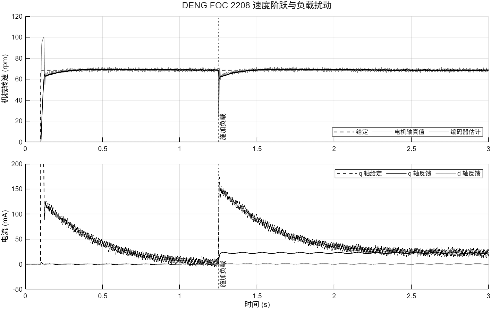

# ESP32-P4 · DENG FOC 2208 闭环仿真

`esp32p4_foc.slx` 将 ESP32-P4 固件的速度外环、两轴电流内环、PWM、三相功率级、电机及传感器连成闭环。打开 `FOC controller` 可逐块查看反馈、PI、滤波、坐标变换和保护。运行需要 MATLAB 和 Simulink。电机方程和逆变器均在模型内实现。

## 运行和改参数

在 MATLAB 中将当前文件夹切到本目录，执行

```matlab
open_system('esp32p4_foc')
out = sim('esp32p4_foc');
```

顶层的速度示波器对照给定、编码器估计和电机轴真值，单位为电 rad/s。电流示波器对照两轴给定与滤波反馈，单位为 mA。`out.logsout` 还记录三相电流、PWM 码、相电压、转矩和保护信号。

**可调参数集中在 [esp32p4_foc_data.m](esp32p4_foc_data.m)**，它是模型工作区的数据源。改电机、PI 增益、电流上限、PWM 位数、载波频率、分流电阻、安装方向或试验给定后，保存该文件。若模型已打开，重新读取参数再运行即可。

```matlab
reload(get_param('esp32p4_foc','ModelWorkspace'))
out = sim('esp32p4_foc');
```

单次试验可以覆盖指定参数。例如将电频率给定改为负值，负载转矩同时反向以继续阻碍转动。

```matlab
in = Simulink.SimulationInput('esp32p4_foc');
in = setVariable(in,'target_Hz',-8,'Workspace','esp32p4_foc');
in = setVariable(in,'load_Nm',-0.002,'Workspace','esp32p4_foc');
out = sim(in);
```

默认在 0.10 s 从零给定阶跃到 8 电 Hz，在 1.25 s 加入 0.002 N·m 负载。7 极对对应的机械转速给定为 68.57 rpm。给定、加载时刻、负载幅值和仿真终止时间均可修改。

## 对象参数及其来源

实际对象是灯哥 DENG FOC 套件 2208。用户仓库注明 **7 极对、110 KV、额定 12 V/2 A**。灯哥官网的 2208 双电机调试底座列为 **7 极对、100 KV、12 V、工作电流 200–500 mA、电阻 14.4 Ω**，其中未给出电阻的相绕组或线间测量口径。固件内的 110 KV 用于打印转矩估计，速度 PI 和电流 PI 直接使用采样反馈。[项目硬件说明](../README.md) · [灯哥官方规格表](http://dengfoc.com/dengfoc/DengFOC官方硬件/3无刷电机/3.1_2208.md)

模型采用星接、正弦反电势 PMSM。默认每相电阻 18.76 Ω、相电感 2.58 mH、线间反电势常数 7.68 V RMS/krpm 来自**另一只同套件 2208** 的公开辨识记录。设置 $L_d=L_q$，按线间有效值换算每相磁链。`J_rotor` 与 `B_rotor` 暂按该次 Profiler 界面的数值建模，分别为 $5.0\times10^{-7}$ kg·m² 和 $1.07\times10^{-6}$ N·m·s/rad。实机预测应换入手头电机的轴侧测量值。ST 曾说明部分版本的机械参数涉及极对数换算，原记录未确认该版本的处理口径。`J_load` 和 `B_load` 可分别指定附加惯量和摩擦，默认均为零。[样机辨识记录](https://shequ.stmicroelectronics.cn/thread-871150-1-1.html) · [原始结果截图](https://shequ.stmicroelectronics.cn/data/attachment/forum/202607/09/225133ktcvczmommrmz6ul.png) · [ST 关于换算的说明](https://community.st.com/stm32-mcus-motor-control-34/speed-loop-pid-tuning-in-esc001v1-153312)

## 固件与仿真的对应

| 模块 | 实现 |
|---|---|
| `FOC controller` | 同一拍运行速度 PI 与两轴电流 PI。用旧积分计算本拍输出，按饱和方向决定是否积分。逐轴限幅后再对电压矢量限幅。原始相电流连续超限后先输出三相中点，再撤销使能。 |
| `Current and position sensors` | U、V 两相分流和 INA199、ADC 毫伏整数换算、逐相零点和极性修正、AS5600 角度量化。测速使用编码器原始方向，预测电角度同时送入 Park 和反 Park。 |
| `PWM and inverter` | 10 位计数与浮动星点三相电压。默认 `pwm_switching=0` 使用平均桥。改为 `1` 可按 20 kHz 载波逐步计算导通时间。观察开关纹波时可将 `Ts_plant` 改为 2 µs。 |
| `PMSM and shaft` | 电阻、电感、反电势、交叉耦合、磁链转矩、惯量、摩擦和负载。以 RK4 推进电机状态，输出三相电流、机械角、机械速度和电磁转矩。 |

模型从**已标定、已使能、进入闭环**的状态开始。静止零点在无噪声条件下按同一 ADC 模型换算，两次过采样和 200 组零点平均均等于同一读数。ADC 默认采用固件提供的线性后备换算。控制任务以固定 `Ts_ctrl` 近似实机循环，保留读角成功时间窗及失败衰减。采样未加入 I²C 传输延迟、开关噪声与死区。EN 撤销后以三相等端电位近似，实际高阻续流取决于驱动板。[固件控制任务](https://github.com/BassttElSevic/esp32p4-foc/blob/c20fad4021fcaa4c48edd10f71dbba7408f10d8e/firmware/foc/main/main.c#L710-L986)

## 重建与验证

`.slx` 可直接打开。需要从 Git 中的文本源重建时，运行 `build_esp32p4_foc`。子系统构建函数在 [private](private/)。

```matlab
[results, trace] = verify_esp32p4_foc;
fig = plot_esp32p4_foc(trace);
```

验证使用 Simulink normal mode 运行正转加载、反转加载和开关逆变器工况，并在独立测试模型中向同一控制子系统注入相电流。过流试验在第 100 ms 将相电流降到恰等于阈值，再持续超限，以核对严格大于、计数清零、三相中点和 EN 延时。

### R2025b 默认工况结果

| 观测量 | 正转 | 反转 |
|---|---:|---:|
| 给定机械转速（rpm） | 68.571 | −68.571 |
| 末 0.30 s 平均轴速（rpm） | 68.612 | −68.600 |
| 末 0.30 s 平均估计转速（rpm） | 68.609 | −68.599 |
| 末 0.30 s 轴速跟踪误差 RMS（rpm） | 0.995 | 0.955 |
| 末 0.30 s 平均真实 q 轴电流（mA） | 22.37 | −22.38 |

加载后轴速明显下陷。以“此后每个控制采样点直到 3 s 结束都落在 ±2% 带内”为判据，正转最后一次回到带内是在加载后 1.742 s，反转到仿真结束仍有采样点越界。因此默认配置返回 `results.reverse.passed=false`。这一判据直接作用于电机轴真值，平均转速和经过滤波的估计转速另存。

开关工况检查了同一控制给定下的 20 个完整载波周期，三相平均电压与对应 PWM 码的计算值一致。过流试验在 0.250 s 切换到三相中点 512，在 0.270 s 拉低 EN。额外的参数覆盖试验将速度 PI 增益置零并修改 PWM 位数，验证模块直接响应工作区参数。


